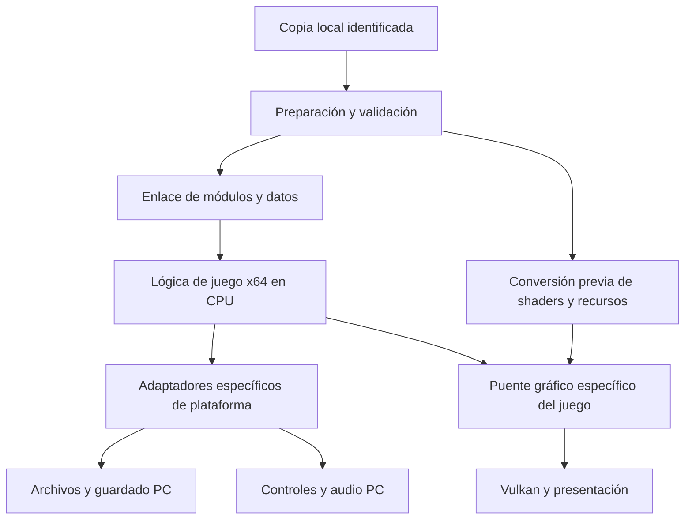

# Plan del port nativo de Gravity Rush Remastered para PC

> **Lectura del estado:** este documento conserva el baseline y los criterios del plan inicial. Para el avance posterior y las limitaciones verificadas, consultar [CONTRASTE_AVANCE.md](CONTRASTE_AVANCE.md) y el [lote de ejecución implementado](EJECUCION_LOTE_ARRANQUE.md).

Fecha de revisión: 23 de octubre de 2026.
Objetivo confirmado por el usuario: jugar en su PC con su copia del juego,
mediante el port y el runtime propios del proyecto. No se propone un emulador
externo como producto final.

## 1. Conclusión y alcance

El proyecto tiene una base host útil y un inspector de ejecutables. Todavía no
tiene un port jugable, un motor del juego reconstruido ni una herramienta de
recompilación estática. El siguiente avance debe demostrar ejecución controlada
de lógica y compatibilidad binaria; añadir más opciones al lanzador no resuelve
ese bloqueo.

La arquitectura propuesta conserva lo implementado: ejecutable Windows x64,
lógica del juego sobre la CPU, adaptadores específicos para sus dependencias,
renderizado Vulkan y audio, entrada, archivos y guardado nativos. Se debe
reducir el trabajo de adaptación durante la partida mediante preparación previa
de recursos, shaders y tablas de enlace, siempre que las evidencias permitan
hacerlo.

Hay que precisar el término «nativo»:

- El lanzador ya es un programa Windows; eso no significa que el juego esté portado.
- Ejecutar el código x86-64 original directamente con servicios adaptados es
  una adaptación binaria con una capa de compatibilidad.
- Compilar toda la lógica a un ejecutable Windows independiente del código
  original exige fuentes reconstruidas o recompilación estática. Esa capacidad
  no existe hoy en el proyecto y sería un bloque adicional de gran dificultad.
- Un producto sin un emulador externo sí encaja con el objetivo. Prometer que
  ninguna parte traduce semántica de PS4 no encaja con reutilizar sus binarios,
  comandos gráficos y shaders sin transformarlos.

Recomendación de ingeniería: construir un port específico del juego con CPU
directa y subsistemas PC, y decidir la conversión estática completa de CPU
mediante una prueba técnica. No asumir que recompilar x86-64 a x86-64 reducirá
por sí solo el coste dominante.

## 2. Qué significa producto terminado

Alcance inicial: Windows, CUSA01130, una versión del juego identificada y este
equipo. No incluye un emulador general, multijugador, 4K ni framerate desbloqueado.

El producto final debe:

1. Preparar y validar los archivos de la copia local sin modificarlos.
2. Abrir el juego desde un acceso directo y mostrar mensajes claros ante fallos.
3. Permitir comenzar, recorrer y terminar la campaña; validar también el
   contenido adicional incluido en la copia que se declare soportado.
4. Mantener controles completos de movimiento, cámara, gravedad, combate,
   menús y las acciones que dependan de sensores/touchpad.
5. Reproducir textos, cómics, cinemáticas, música, efectos y voces necesarios
   sin bloquear el progreso.
6. Guardar, cerrar el proceso y recuperar la partida correctamente.
7. Cumplir una meta de fluidez acordada y medida, sin fugas o fallos recurrentes.
8. Funcionar sin el entorno de desarrollo ni las DLL de MSYS2 en PATH.

Una primera partida de 30 minutos con guardado es un hito jugable. No prueba
que el juego completo esté terminado.

## 3. Evidencia actual y límites

Esta revisión inspecciona código, contratos, scripts, pruebas, registros y hojas
de desarrollo. Utiliza la última validación registrada de 14/14 suites en Debug
y Release; no representa una nueva partida ni una ejecución del juego.

| Área | Evidencia actual | Trabajo pendiente |
| --- | --- | --- |
| Compilación | Biblioteca y ejecutables C++23/Clang; 14 suites | Versiones fijadas, control de cambios y distribución autónoma |
| Memoria | Reserva, commit/decommit, permisos y reversión | Mapa de memoria del juego, asignadores y casos de ejecución |
| SELF/ELF | Carga validada, entrada localizada | Entorno de arranque, módulos y ciclo de vida |
| Relocalizaciones | 303.268 posiciones procesadas, incluidas RELA/PLT | Resolver dependencias con contratos auténticos |
| Importaciones | 669 nombres sin resolver en la inspección local | Identificar biblioteca, módulo, firma, tipo y uso |
| Kernel | Primitivas host probadas | Exports binarios, hilos, TLS y semántica esperada por el juego |
| Fibras | Cambios de contexto host y wrappers preliminares | Layout, pilas reales, TLS y compatibilidad desde código invitado |
| Archivos | 5 PSARC montados y 21.897 archivos indexados en el registro | API usada por el juego, lectura parcial y streaming |
| Gráficos | Ventana Vulkan y presentación de un cuadro de limpieza | Comandos reales, recursos, shaders, pipelines y dibujos |
| Entrada | Teclado y ratón; orientación simulada | Cámara completa, mando real, foco, sensores y configuración |
| Audio | WASAPI y escritura de silencio probada | Motor de voces, decodificación, mezcla y sincronización |
| Guardado/servicios | Sin implementación de producto | Persistencia, usuario local, diálogos y servicios mínimos |
| Arranque | El inspector termina sin llamar a la entrada | Primera ejecución y progreso hacia menú/partida |

Los 669 nombres no equivalen necesariamente a 669 funciones: pueden incluir
símbolos de datos y nombres cualificados. Tampoco son el total garantizado del
producto: cargar módulos adicionales puede descubrir dependencias nuevas.
El antiguo inventario de 42 PRX se basaba en una auditoría preliminar y no debe
tratarse como un grafo de dependencias completamente resuelto.

## 4. Correcciones necesarias al plan anterior

Las hojas antiguas conservan casillas de fases completadas que no corresponden
a los criterios de un port jugable. Deben considerarse material histórico.

- Aplicar relocalizaciones no demuestra que las funciones importadas funcionen.
- Incrementar un contador de dibujos no demuestra renderizado.
- Reservar una pila o copiar sus bytes no demuestra ejecución sobre esa pila.
- Guardar TLS en un slot de Windows no demuestra que las instrucciones del
  juego accedan a su TLS correctamente.
- La presencia de AvPlayer o NGS2 no demuestra qué contenido pasa por ellos.
  Deben observarse las llamadas y formatos reales.
- La técnica concreta de contornos «Inverted Hull» está descrita sin una captura
  que la pruebe. No se deben introducir correcciones visuales basadas en esa
  suposición antes de analizar los shaders y las pasadas.
- «Acceso instantáneo sin latencia» y «todas las fases al 100 %» no son métricas.
- No hay un recompiler de CPU, un decodificador de PM4 ni un traductor de shaders
  conectados al producto actual.

## 5. Arquitectura prevista

Flujo propuesto:

Separar seis responsabilidades:

- **Preparador:** inventario, hashes, versión, recursos convertidos y cachés.
- **Cargador/enlazador:** datos, código, símbolos y módulos. No decide reglas de juego.
- **Ejecución:** pila, TLS, hilos, llamadas, errores y cierre.
- **Adaptadores:** contratos requeridos por esta edición hacia servicios Windows.
- **Renderizador:** recursos y trabajo GPU; recibe operaciones verificadas.
- **Aplicación:** configuración, selección de archivos, arranque y diagnósticos.

Los backends existentes se reutilizan donde sus contratos sean adecuados.
Sus nombres sce* no certifican las firmas originales: deben verificarse antes
de conectarlos a una importación.

## 6. Fases y criterios de salida

Todas las fases siguientes son propuestas pendientes. Su salida requiere
evidencia, no solo archivos creados o compilación correcta.

### Fase 0 — Fijar alcance y una base reproducible

**Trabajo:** identificar versión/región/actualización; manifiesto de archivos y
hashes; copia de seguridad del código; iniciar control de versiones local;
separar pruebas host, ABI e integración; retirar estados ficticios del seguimiento.
Registrar equipo, toolchain, configuración y contenido exacto de cada prueba.

**Entregables:** manifiesto local, baseline reproducible y matriz de funciones.
**Salida:** reconstrucción desde cero y los mismos resultados con los mismos datos.
**Dificultad:** baja a media. **Dependencias:** ninguna.

### Fase 1 — Inventario real de dependencias

**Trabajo:** exportar las tablas dinámicas a JSON, decodificar identificadores de
biblioteca/módulo y cruzar cada símbolo con su firma y procedencia. Inspeccionar
también los módulos necesarios incluidos en sce_module. Clasificar: implementar,
adaptar, cargar temporalmente, sustituir o servicio opcional no requerido.

El inventario necesita NID, nombre cuando esté verificado, biblioteca, módulo,
tipo, versión, firma, prioridad, evidencia y estado. No resolver solo por el NID
ignorando los calificadores si puede haber colisiones.

**Entregables:** imports.json, dependencias.json y lista de incertidumbres.
**Salida:** todos los nombres actuales están clasificados o marcados expresamente
como desconocidos; no se inventan firmas para cerrar la lista.
**Dificultad:** alta. **Dependencias:** fase 0.

### Fase 2 — Elegir y demostrar el mecanismo de ejecución nativa

**Trabajo:** prototipo pequeño de ejecución directa x64 con código de prueba
propio; comparar con una prueba limitada de generación estática si se exige
transformar la lógica a un artefacto Windows. Auditar direccionamiento, llamadas
indirectas, callbacks, TLS, instrucciones dependientes de plataforma y accesos
a servicios del sistema. Implementar adaptación solo donde aparezca la necesidad.

Antes de arrancar el juego, usar ejecutables de prueba que ejerciten enteros,
flotantes, estructuras, más de seis parámetros, callbacks, varargs, alineación,
pila, BSS, TLS por hilo y retorno. El wrapper actual de seis enteros no cubre
todo ese contrato.

**Entregables:** documento de decisión y runner de pruebas en proceso separado.
**Salida:** código ejecutado en CPU, llamada host y retorno comprobados; TLS
aislado entre dos hilos; fallo trazable y cierre controlado.

**Puerta de viabilidad:** si la conversión estática completa es imprescindible,
demostrar antes una porción con llamadas indirectas y datos globales. No hay
base para anunciar una recompilación completa hoy.
**Dificultad:** muy alta. **Dependencias:** fases 0 y 1.

### Fase 3 — Contratos de plataforma y primer arranque

**Trabajo:** enlace por contrato; identidad de proceso/usuario, asignadores,
hilos y sincronización; constructores e inicializadores identificados; memoria
de proceso y ciclo de carga/descarga de módulos. Resolver TLS real y el contrato
de inicio antes de transferir ejecución al juego.

Fibras es un riesgo prioritario: el SceFiber actual contiene host_fiber dentro
de una estructura presentada al juego. Hay que verificar su layout y, si ese
campo no pertenece al contrato original, conservar el estado host en una tabla
externa. Las pilas deben usarse realmente si el juego depende de ellas:
CreateFiberEx más una copia de memoria no basta para demostrar equivalencia.
Medir también el coste de copiar guest_stack_shadow en cada cambio.

No rellenar importaciones con funciones que devuelvan éxito vacío. Una llamada
pendiente debe registrar módulo/NID, hilo, dirección de llamada y argumentos
seguros para diagnóstico. La política para símbolos opcionales necesita contrato.

**Entregables:** runner de arranque, informe de llamadas y adaptadores básicos.
**Salida:** primera ejecución del juego que alcance una solicitud real de recurso
o inicialización de subsistema de forma repetible, sin corrupción conocida.
**Dificultad:** muy alta. **Dependencias:** fases 1 y 2.

### Fase 4 — Recursos y almacenamiento nativos

**Trabajo:** decidir a qué nivel interceptar archivos según las llamadas reales.
Si se reutiliza temporalmente un módulo que ya entiende PSARC, evitar descomprimir
el mismo recurso en dos capas. Añadir stat, directorios, rutas, errores, offsets
y semántica asíncrona que el juego use.

El VFS actual descomprime un archivo completo al abrirlo y lo copia a un vector.
Sustituir esa estrategia por lectura de rangos/bloques, caché limitada, precarga
y colas cuando las medidas de streaming lo justifiquen. Considerar conversión
previa a un paquete local PC con índice y versión.

**Entregables:** lector de producción y pruebas de integridad sobre recursos.
**Salida:** lecturas del juego correctas, carga/cambio de zona sin bloqueo y
memoria de caché limitada; equivalencia entre original y recurso preparado.
**Dificultad:** alta. **Dependencias:** fases 1 y 3; prototipos desde fase 1.

### Fase 5 — Primer renderizado nativo real

**Trabajo:** establecer el límite gráfico que usa el juego. Primero un triángulo
sintético con vertex/index buffers, shaders, textura, profundidad y sincronización.
Después capturar el primer envío real y reconstruir su estado de forma verificable.

Si se conservan envíos GNM/PM4, hace falta entender registros, paquetes, draws,
dispatches, copias, etiquetas y esperas usados por el juego. Los setters actuales
son una abstracción interna y no reemplazan automáticamente esa interfaz.

Definir objetos propios para buffers, imágenes, samplers, descriptores, formatos,
tiled/swizzled layouts, memoria compartida CPU/GPU y vida útil de recursos.
Una dirección de memoria de PS4 no es por sí sola un recurso Vulkan válido.

**Entregables:** backend de recursos y captura reproducible de un dibujo del juego.
**Salida:** primera imagen procedente del juego y comandos Vulkan válidos,
incluida sincronización; no cuenta el color de limpieza del fondo.
**Dificultad:** muy alta. **Dependencias:** fases 1 y 2 para prototipo;
fase 3 para primera captura real.

### Fase 6 — Shaders y adaptación gráfica específica

**Trabajo:** obtener shaders reales, identificar etapas y semántica requerida y
traducirlos a SPIR-V o reconstruir equivalentes con pruebas de referencia.
Establecer qué se puede convertir antes de jugar y qué variantes se descubren
durante la partida. Cubrir compute solo si aparece, además de gráficos.

Crear manifiestos de shaders y pipelines, hashes e invalidación por versión.
Distinguir SPIR-V portable de la caché de pipeline específica del dispositivo.
Añadir replay de capturas para probar pasadas sin repetir todo el arranque.

Reproducir materiales, animación, sombras, transparencias, postprocesado,
interfaz y texto según evidencia. Reemplazar rutas costosas por operaciones
nativas específicas después de probar que conservan su resultado. No imponer
contornos ni depth bias basándose en la apariencia artística.

**Entregables:** conversor previo, caché y conjunto de capturas de regresión.
**Salida:** escena controlable con interfaz correcta y recursos estables;
las variantes pendientes se detectan y no se silencian.
**Dificultad:** muy alta; uno de los mayores bloques del proyecto.
**Dependencias:** fase 5 y recursos de fase 4.

### Fase 7 — Audio, contenido audiovisual y controles completos

**Trabajo de audio:** observar voces, buses, formatos y sincronización usados.
Crear mixer, decodificadores necesarios, cola/ring buffer y salida WASAPI en
un hilo propietario. El contrato de audio del juego debe adaptarse a esa cola:
hacerlo llamar directamente al cliente WASAPI desde cualquier hilo sería incorrecto.

**Trabajo de contenido:** comprobar si AvPlayer se usa realmente y para qué.
Implementar la ruta de vídeo/texturas/sincronización requerida; no asumir que
todos los cómics son películas.

**Trabajo de entrada:** mando real, ejes analógicos, cámara, gravedad, acciones
touchpad, foco de ventana y captura relativa del ratón. Leer configuración.
Validar unidades y que el mismo movimiento produzca un resultado equivalente
a 30/60/120 actualizaciones por segundo; los valores actuales mezclan deltas
de píxel y cantidades descritas como velocidades.

**Salida:** tutorial jugable con todas sus acciones, audio continuo y secuencias
que permiten continuar. **Dificultad:** alta. **Dependencias:** fases 3 a 6.

### Fase 8 — Guardado y primera versión jugable

**Trabajo:** usuario local, mount de guardados, metadatos, escrituras atómicas,
recuperación de fallos y copia de seguridad. Diálogos y servicios mínimos que
permitan progresar sin simular conexiones exitosas inexistentes.

**Salida:** completar una sección representativa, guardar, cerrar el proceso,
abrir otra vez y continuar en tres ciclos. Probar también la ausencia de partida,
guardado interrumpido y cambios de zona.
**Dificultad:** media a alta. **Dependencias:** fases 4, 6 y 7.
El diseño de persistencia comienza antes para no perder avances de pruebas.

### Fase 9 — Rendimiento del port en este PC

**Trabajo:** medir tiempo CPU, GPU, adaptación de APIs, comandos, compilación,
descompresión, espera y presentación. Utilizar escenarios repetibles: ciudad,
combate, gravedad, cómic/cinemática y transición de zona.

Priorizar según el cuello observado: precálculo de shaders, caché de pipelines,
batching, reducción de readbacks, recursos persistentes, actualización parcial,
asignadores reutilizables, streaming y eliminación de copias de pilas. Registrar
resultados antes/después. No quitar sincronización o efectos solo para mejorar
un contador sin verificar comportamiento.

**Salida:** presupuesto de cuadros acordado, sin crecimiento de memoria sostenido
en una sesión representativa de dos horas y sin cambiar la velocidad de lógica.
**Dificultad:** alta y dependiente de lo descubierto. **Dependencias:** fase 8;
instrumentación desde fase 2.

### Fase 10 — Producto final personal y validación completa

**Trabajo:** empaquetado Windows sin toolchain, preparación de datos, configuración
persistente, acceso directo, controles recuperables y diagnósticos entendibles.
Congelar versiones de código/datos/driver usadas en la validación.

**Salida:** campaña completa y contenido declarado soportado; lista de escenarios
y problemas conocidos; guardados recuperables; arranque sin entorno de desarrollo;
sesiones prolongadas y rendimiento repetible. Un logo o menú no cierra esta fase.
**Dificultad:** media en empaquetado; alta en cobertura. **Dependencias:** fase 9.

## 7. Dependencias e hitos visibles

| Hito | Qué se debe poder demostrar |
| --- | --- |
| M0 — Situación actual | Inspector y backends host; última validación 14/14 |
| M1 — Viabilidad de CPU | Código de prueba, ABI y TLS ejecutados correctamente |
| M2 — Primer arranque real | Lógica del juego alcanza inicializaciones/lecturas identificables |
| M3 — Primer cuadro del juego | Dibujo real con shaders y recursos correctos |
| M4 — Menú y escena controlable | Entrada, interfaz y primera escena integradas |
| M5 — Primera versión jugable | Tutorial/sección, sonido y guardado/reinicio |
| M6 — Versión estable | Sesión prolongada y objetivos de rendimiento medidos |
| M7 — Producto personal final | Campaña y contenido declarado validados y ejecutable autónomo |

Ruta crítica: inventario -> ejecución/ABI/TLS -> arranque -> primer cuadro ->
escena -> guardado/audio/control -> estabilidad -> campaña completa.
El prototipo gráfico sintético puede avanzar antes del arranque real, pero no
certifica compatibilidad con el juego.

## 8. Rendimiento: objetivo, medición y límites

Equipo detectado: Intel Core i7-10700F, 8 núcleos/16 hilos; RTX 3050 con 8 GiB
de VRAM; aproximadamente 32 GB de RAM. NVIDIA informa driver 621.01.
Esto describe la máquina de prueba; no garantiza un framerate del juego.

Meta inicial propuesta: 1920x1080 a 60 FPS con velocidad de juego correcta.
A 60 FPS el intervalo de presentación es 16,67 ms. CPU y GPU se solapan:
no sumar sus tiempos sin analizar la cola y la dependencia que limita el cuadro.

Registrar mediana, percentiles 95/99 de frametime, cuadros por encima de 33,3 ms,
uso y pico de RAM/VRAM, tiempo de carga, compilaciones durante juego, readbacks
y fallos de audio. Separar caché fría de caché caliente.

Propuesta de aceptación a confirmar con M5: en recorridos repetibles de 10 minutos,
aproximadamente 60 FPS en régimen estable, p95 <= 18 ms y p99 <= 25 ms, excluyendo
pantallas de carga identificadas; sin pausas recurrentes de compilación. Son metas
de diseño, no resultados medidos ni promesas de este hardware.

El ahorro esperado debe atribuirse a cambios medidos, no a la etiqueta «nativo».
La documentación de diseño de shadPS4 describe ejecución directa del código CPU
y adaptación de servicios, además del procesamiento gráfico. Por tanto, evitar
un intérprete de CPU no distingue por sí solo este proyecto de todas las soluciones
existentes. Nuestra ventaja tendría que venir de un alcance específico, conversión
previa y rutas PC mejor adaptadas. [Diseño técnico de referencia](https://github.com/shadps4-emu/shadPS4/wiki/VI.-Emulator-Design-%5BDevs%5D).

La ficha de CUSA01130 documenta ejecución ingame con problemas de rendimiento.
Se usa como referencia de problemas y escenas para medir; no como propuesta de
reemplazo del port ni como prueba de rendimiento de este PC.
[Registro de CUSA01130](https://github.com/shadps4-compatibility/shadps4-game-compatibility/issues/159).

## 9. Riesgos y decisiones que no conviene posponer

| Riesgo | Por qué afecta | Cómo reducirlo |
| --- | --- | --- |
| Definición ambigua de port nativo | Cambia por completo el alcance | Decisión escrita en fase 2 |
| ABI y layouts incorrectos | Corrupción incluso con importación resuelta | Pruebas desde código invitado y layouts contrastados |
| Pilas/TLS solo aproximados | Fallos de concurrencia y coste oculto | Prueba real de acceso/aislamiento y contexto |
| Recompiler CPU inexistente | Convertir toda la lógica puede ampliar mucho el proyecto | Prueba limitada antes de prometerlo |
| Shaders y GPU sin traducción | Principal bloqueo visual | Captura/replay y conversión incremental |
| API de archivos demasiado simplificada | Lecturas correctas en prueba, incompatibles con el juego | Contratos y trazas reales |
| Dependencias transitorias | Aumentan los imports al cargar módulos | Grafo de dependencias y procedencia |
| Doble adaptación de recursos | CPU y RAM desperdiciadas | Un único responsable por formato/capa |
| Estado «completado» sin evidencia | Progreso aparente sin juego | Hitos con artefactos y pruebas de salida |
| Optimización prematura | Se cambia código que no limita el cuadro | Perfil antes/después por escenario |

No existe una estimación seria de fecha final antes de M2 y de una prueba de
shaders reales. Juicio de planificación: si se construyen ABI, arranque y conversión
gráfica desde esta base, es un proyecto de varios meses o más, no una serie corta
de arreglos. Reconstruir toda la lógica puede ampliar todavía más el alcance y
no tiene éxito garantizado. Reestimar tras M1, M2 y M3 usando trabajo observado.

## 10. Próximo lote de trabajo

Este es el orden recomendado para la siguiente implementación, no trabajo ya hecho:

| ID | Prioridad | Tarea | Criterio de aceptación |
| --- | --- | --- | --- |
| N01 | P0 | Baseline y manifiesto de copia/versión | Datos y builds reproducibles sin cambiar el original |
| N02 | P0 | Exportar imports y dependencias | JSON completo con calificadores y desconocidos explícitos |
| N03 | P0 | Decisión CPU directa/conversión estática | Prototipo y límites escritos; sin promesas no probadas |
| N04 | P0 | Runner aislado con diagnóstico | Error con dirección, hilo y módulo; timeout y cierre |
| N05 | P0 | Matriz ABI y estructuras | Pruebas de argumentos, callbacks y layout |
| N06 | P0 | TLS y contexto/pilas | Aislamiento entre hilos y fibras desde código ejecutado |
| N07 | P0 | Registro tipado de adaptadores | Importación verificada o fallo explícito |
| N08 | P0 | Primer arranque instrumentado | Primera llamada/lectura real reproducible |
| N09 | P1 | Triángulo y recursos Vulkan | Draw con shader/textura y validación gráfica |
| N10 | P1 | Primera captura de comandos/shader del juego | Datos suficientes para replay y conversión |
| N11 | P1 | Streaming de archivos de producción | Lecturas parciales, caché limitada y equivalencia |
| N12 | P1 | Plan de persistencia y pruebas de control | Casos completos definidos antes de la primera partida |

N01-N08 forman el lote prioritario. N09 es un prototipo útil, pero no sustituye
resolver el contrato de ejecución. N10 requiere que el juego alcance envíos
gráficos; si aún no lo hace, se registra el bloqueo en lugar de inventar comandos.

No empezar ahora por resolución 4K, FPS desbloqueados, una GUI elaborada,
recrear artificialmente cel-shading o implementar servicios online no observados.

## 11. Evidencia y seguimiento

Por tarea, guardar: estado (pendiente/prototipo/validado/bloqueado), configuración,
hash de datos, prueba ejecutada, resultado, limitación y dependencia siguiente.
Un porcentaje global de «port completado» sería engañoso con las incógnitas actuales.

Fuentes locales revisadas:

- [Estado y compilación](../README.md).
- [Estabilización y pruebas registradas](ESTABILIZACION.md).
- [Cargador](../engine/src/loader/elf.cpp) y [resolvedor](../engine/src/loader/reloc.cpp).
- [Fibras](../engine/src/fiber/fiber.cpp) y [estructuras preliminares](../engine/include/hle/orbis_error.h).
- [VFS](../engine/src/fs/fs.cpp), [GNM](../engine/src/gnm/gnm.cpp), [vídeo](../engine/src/video.cpp).
- [Audio](../engine/src/audio/audio.cpp) y [controles](../engine/src/pad/pad.cpp).
- [Pruebas de integración](../tests/runtime_tests.cpp) y [regresiones](../tests/stabilization_tests.cpp).

Las referencias externas anteriores sirven para contrastar arquitectura y problemas
documentados. No se instaló, integró ni ejecutó un emulador externo en esta revisión.

